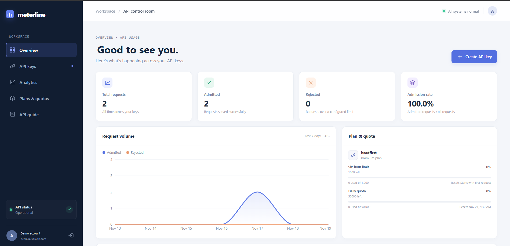
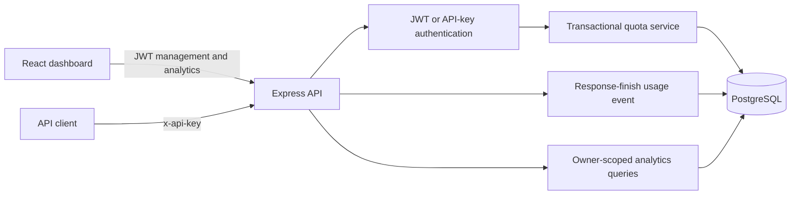

# API Usage Metering Platform

A Node.js, Express, and PostgreSQL service for issuing API keys, enforcing per-key rolling rate limits and UTC daily quotas, recording authenticated request usage, and exploring that usage through a React dashboard.

## Dashboard preview



## Problem and objectives

API providers need to identify clients, control how much each client can consume, and explain that consumption to account owners. This project demonstrates those capabilities with a transactional PostgreSQL counter model, authenticated management APIs, event-based analytics, and a browser dashboard.

## Features

- Argon2id registration and login; short-lived, signed JWTs protect management routes.
- Cryptographically random API keys are returned at creation and only their SHA-256 hashes are stored.
- Per-key rolling plan limits and daily UTC quotas are admitted together in one transaction.
- Authenticated API requests record status, endpoint, latency, admission result, and timestamp.
- Owner-scoped summary, time-series, per-key, endpoint, and recent activity analytics.
- Responsive React dashboard for overview, keys, analytics, plans/quotas, and API usage instructions.
- SQL migrations, database seeds, serial integration tests, and a local benchmark script.

## Technology

| Area | Technology |
| --- | --- |
| API | Node.js ES modules, Express 5 |
| Storage | PostgreSQL, `pg` connection pool, SQL migrations |
| Identity | Argon2id, JWT (`jsonwebtoken`) |
| API-key handling | Node crypto, SHA-256 digest lookup |
| Backend verification | `node:test`, Supertest |
| Dashboard | React, Vite, React Router, Recharts, plain CSS |
| Frontend verification | Vitest, jsdom, Testing Library |

## Architecture

The browser calls the Express API. JWT-protected routes manage users' keys, plans, and analytics. The sample metered endpoint accepts `x-api-key`; authentication looks up its digest, then the quota service locks the corresponding key row and checks both counters before committing either increment. A response-finish handler records the authenticated request for later analytics.



## Repository layout

```text
src/
  app.js, server.js          Express app and process lifecycle
  config/                    Validated runtime configuration
  database/                  Pool, migrations, and seeds
  modules/                   Auth, keys, plans, quotas, usage, analytics
tests/                       Feature-oriented integration tests and helpers
frontend/                    Vite/React dashboard and component tests
scripts/                     Local benchmark
```

## Database design

The schema has `users`, `plans`, `api_keys`, `api_key_daily_usage`, `api_key_rate_limit_windows`, `usage_events`, and `schema_migrations`. A user owns API keys; a key references one plan and has independent daily and rolling-window counters; usage events reference the key. Migrations define the primary keys, foreign keys, unique and check constraints, and lookup indexes.

The seeded plans are Free (200 requests per 21,600-second window; 1,000 per UTC day) and Premium (1,000 per 21,600-second window; 50,000 per UTC day). Limits are loaded from PostgreSQL, not hardcoded in the dashboard.

## Requirements

- Node.js 20.19+ or 22.12+ (required by Vite 8).
- PostgreSQL 15 or newer (the implementation uses standard PostgreSQL features; validation was performed with PostgreSQL 18.4).
- npm.

## Setup

Install backend and dashboard dependencies from the repository root:

```sh
npm ci
npm ci --prefix frontend
```

Create a PostgreSQL database and role for local development. Copy `.env.example` to `.env`, set the database values, and replace the JWT secret with at least 32 random bytes. The `.env` file is ignored by Git.

```sh
cp .env.example .env
```

Generate a development secret with Node:

```sh
node -e "console.log(require('node:crypto').randomBytes(32).toString('hex'))"
```

### Migrate and seed

The SQL scripts use the active dotenv configuration and therefore target `.env` by default. Verify that `.env` points to your intended development database before running these commands; never point them at production.

PowerShell:

```powershell
$env:DOTENV_CONFIG_PATH = '.env'
node src/database/run-migrations.js
node src/database/run-seeds.js
Remove-Item Env:DOTENV_CONFIG_PATH
```

Bash:

```sh
DOTENV_CONFIG_PATH=.env node src/database/run-migrations.js
DOTENV_CONFIG_PATH=.env node src/database/run-seeds.js
```

Migrations are forward-only and each pending migration is applied transactionally. Seeds upsert the two plan definitions.

### Start the API and dashboard

Run the API in one terminal:

```sh
npm start
```

Run Vite in a second terminal:

```sh
npm run dev --prefix frontend
```

Vite serves the UI locally and proxies `/api` to `http://127.0.0.1:3000`. Set `API_PROXY_TARGET` in the frontend process environment to proxy to a different local API. For a separately hosted production UI, set `VITE_API_BASE_URL` to the API base URL and configure an explicit CORS policy before deployment; CORS is disabled in this API.

The API exposes `/health` for liveness and `/health/ready` for PostgreSQL readiness.

## Environment variables

| Variable | Required | Default / rule | Purpose |
| --- | --- | --- | --- |
| `DB_HOST` | Yes | — | PostgreSQL host |
| `DB_PORT` | No | `5432` | PostgreSQL port |
| `DB_NAME` | Yes | — | Database name |
| `DB_USER` | Yes | — | Database role |
| `DB_PASSWORD` | Yes | — | Database password |
| `JWT_SECRET` | Yes | At least 32 bytes | JWT signing secret |
| `PORT` | No | `3000` | API listen port (0 is useful for tests) |
| `DB_POOL_MAX` | No | `10`, range 1–100 | Maximum pool clients |
| `AUTH_LOGIN_MAX` | No | `10` | Login requests per client IP per 15-minute window |
| `AUTH_REGISTER_MAX` | No | `10` | Registration requests per client IP per hour |
| `TRUST_PROXY` | No | Disabled | Exact proxy hop count/value used for Express IP selection |
| `DOTENV_CONFIG_PATH` | No | dotenv default (`.env`) | Select a dotenv file for backend scripts |
| `TEST_ENV_FILE` | No | `.env.test` | Test helper environment file override |
| `VITE_API_BASE_URL` | No | `/api` | Browser API base URL for built frontend |
| `API_PROXY_TARGET` | No | `http://127.0.0.1:3000` | Vite development proxy target |

For tests, create `.env.test` from `.env.test.example` and use a dedicated database whose name ends with `_test`. The test harness refuses a missing, non-`_test`, or development-matching database name and verifies the connected database identity before migrations or cleanup. Keep both actual environment files and all credentials out of Git.

## Test and benchmark commands

```sh
npm test
npm test --prefix frontend
npm run build --prefix frontend
```

The backend test command runs Node's test runner with file concurrency set to one. It loads `.env.test`, applies pending SQL migrations and plan seeds to that database, and resets application tables between test cases. The frontend test runner uses a single worker and jsdom. For the benchmark, configure `.env.test` and run `npm run benchmark`; the script checks the database suffix and difference from `.env` before it creates/removes benchmark rows.

The backend suite covers authentication, API-key ownership and revocation, quotas and rate limits including concurrency, usage metering, analytics, health, process lifecycle, and migrations/seeds on an isolated fresh schema. The frontend suite covers authentication, dashboard flows, and a live API integration against the guarded test database.

## API quick reference

Management routes use `Authorization: Bearer <JWT>`. The metered test route uses `x-api-key: <raw-key>`.

```sh
curl -H 'x-api-key: YOUR_RAW_KEY' http://127.0.0.1:3000/api/test
```

An admitted response is `200` with `message`, `apiKeyId`, `ownerId`, `planId`, current `rateLimit`, and `dailyQuota`. A rate or quota rejection is `429` with an `error`, `limit`, `remaining`, and `resetAt`; response headers identify the applicable limit and reset.

## Security and known limitations

- JWTs are HS256, issuer/audience constrained, and expire after 15 minutes. The dashboard keeps the JWT in React memory, not browser storage.
- API-key hashes and password hashes are never returned. A raw API key is shown once at creation.
- Authentication abuse limits are process-local and do not coordinate across multiple API instances.
- PostgreSQL is on the synchronous quota-admission path. Contending requests for one key serialize on its row; local benchmark results do not establish production capacity.
- Usage recording is asynchronous after response finish. A process or database failure can lose an event.
- Expired rolling-window rows are not currently pruned; migrations have no down scripts.
- CORS is disabled; configure an explicit origin allowlist if the UI is hosted separately. TLS termination, secrets management, monitoring, deployment, and production-scale behavior have not been verified.
- Before deployment, check both dependency lockfiles for current advisories by running `npm audit` at the repository root and `npm audit --prefix frontend`.

This repository is a demonstration project and has not been reviewed or certified for production deployment. Before deploying it, configure TLS, a specific CORS allowlist if the UI is hosted separately, secret management, monitoring, and database backups. The implementation also has known limitations: authentication abuse limits are process-local, usage recording is asynchronous, and expired rolling-window rows are not currently pruned.

## Future improvements

Evaluate durable usage delivery, expired-window retention, shared abuse controls for multi-instance deployment, production-like load tests, deployment automation, monitoring/alerting, and a reviewed CORS/TLS edge configuration.
